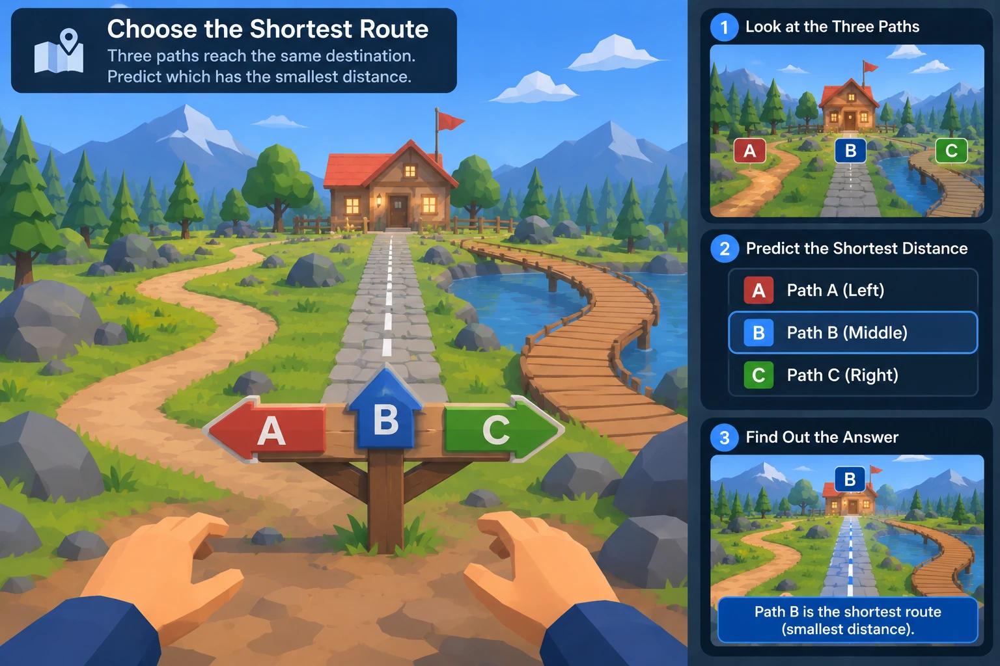

c:\Users\Bhargav\Downloads\dis.webp# MASTER PROMPT — "Distance and Displacement: Choose the Shortest Route" (VR physics game, Unity)

Project root: `D:\Unity Projects\Teaching_And_Learning`
Target scene: `Assets/Scenes/Distance_And_Displacement.unity`
Visual reference: the "Choose the Shortest Route" image — first-person view at a wooden A/B/C signpost; three paths to a red-roof cabin with a red flag: A = winding dirt path (left), B = straight stone path with a white dashed centre line (middle), C = curved wooden boardwalk over a pond (right); pine forest, boulders, snowy low-poly mountains, blue sky with low-poly clouds; title card upper-left; 3 step cards on the right (1 Look at the Three Paths, 2 Predict the Shortest Distance, 3 Find Out the Answer).



Project facts this prompt accounts for:
- `Assets/Scenes/Distance_And_Displacement.unity` exists but is a near-empty 8 KB default scene, so rebuild it.
- glTFast is NOT installed. GLBs are read by copying the project's existing reader `Assets/SpeedTimeGraphFree/Editor/GlbImporter.cs` into the new folder (copy, never reference).
- `USAHouse.zip` contains `USAHouseSF.fbx` + textures. Extract it into the NEW folder; never unzip inside the source folder.
- Big sources: `a-house` GLB 55.7 MB (+ 11.5 MB texture), `stone_brick_path.glb` 45.4 MB, `ground_02.glb` 23.8 MB, so LODs and a performance budget are required.
- Packages available: `com.unity.feature.vr` (XR Interaction Toolkit + OpenXR), XR Hands, Input System, URP 17.5, uGUI/TextMeshPro.
- Correction to the original design notes: a single L-turn path of 20 m can never have 12 m displacement (its minimum is 20/√2 ≈ 14.1 m). Level 2 below uses a U-detour 4 + 12 + 4 = 20 m, which gives exactly 12 m displacement.

Copy everything inside the box below as the prompt.

```text
═══════════════════════════════════════════════════════════════════════
MASTER PROMPT — Build "Distance and Displacement" VR game in Unity
Project root: D:\Unity Projects\Teaching_And_Learning
═══════════════════════════════════════════════════════════════════════

ROLE: You are a senior Unity XR developer and physics-education game designer.
Build ONLY this one scene: a complete, playable 3-level VR game that teaches NCERT
"Distance and Displacement" (distance = total path length; displacement = straight
line from start to current position; a round trip has distance > 0 but displacement 0).
Level 1's start view must match the reference image exactly.

─────────────────────────────────────────────
0. HARD RULES — NO EXISTING CODE MAY CHANGE
─────────────────────────────────────────────
0.1 Do NOT modify, rename, move or remove ANY existing file. Never touch:
      Assets/Scripts/, Assets/Editor/, Assets/ZeroReturn/, Assets/DistanceTimeGraph/,
      Assets/SpeedTimeGraph/, Assets/SpeedTimeGraphFree/, Assets/Speed_Time_Graph*/,
      Assets/RestAndMotion/, Assets/Prefabs/, Assets/XR*/, Assets/Settings/,
      all other scenes in Assets/Scenes/, ProjectSettings/, Packages/manifest.json,
      Build Settings.
0.2 Create ALL NEW code and files. Every script, prefab, material, ScriptableObject,
    editor tool, extracted model and generated asset goes under the NEW folder
    Assets/DistanceDisplacement/  (no spaces in the name).
0.3 Do NOT reference, inherit from, or `using` any other game's namespace/class
    (NumberLinePlayground.*, DistanceTimeGraph, SpeedTimeGraphLesson,
    SpeedTimeGraphFree, RestAndMotion). If a helper is useful, COPY it into the new
    folder, rename the class and put it in this namespace. Third-party art packs
    (e.g. Assets/SimpleNaturePack/Prefabs/Tree_0X, Rock_0X, Bush_0X) may be
    INSTANTIATED read-only but never edited; prefer making new prefab variants
    in the new folder.
0.4 Runtime namespace: DistanceDisplacement. Editor namespace:
    DistanceDisplacement.Editor. Own asmdefs: DistanceDisplacement.asmdef,
    DistanceDisplacement.Editor.asmdef. Menu root: "Tools/Distance And Displacement/...".
    Prefix generic class names with DD (DDGameManager, DDQuestionData, DDGameState).
0.5 The only file outside the new folder you may write is the target scene
    Assets/Scenes/Distance_And_Displacement.unity (rebuild it). Notes/logs:
    Work/DistanceDisplacement/.
0.6 Source assets in "Assets/Distance and Displacement/" are READ-ONLY (no edits to
    GLB/FBX/textures/zip or their import settings).
0.7 Before writing code, record SHA-256 hashes of every existing .cs .unity .prefab
    .asset .mat file in Assets/ (except Distance_And_Displacement.unity) to
    Work/DistanceDisplacement/hashes-before.json. At the end, re-hash and PROVE
    zero pre-existing files changed.
0.8 Before building, render a plan image (top-down map with all paths + exact
    lengths, and the eye view from the signpost) to
    Work/DistanceDisplacement/reference/01_plan.png, show it to me and wait for OK.

─────────────────────────────────────────────
1. SOURCE ASSETS (read-only inputs) → what each becomes
─────────────────────────────────────────────
Folder: Assets/Distance and Displacement/
A) ground_02.glb (23.8 MB)  → terrain ground tiles (grass meadow + dirt clearing
   around the signpost). Bake via the copied GLB reader into
   Assets/DistanceDisplacement/Models/Ground/. Tile/scale to ~120 × 120 m play area.
B) low_poly_home_1.glb (0.3 MB) → THE DESTINATION CABIN (red roof, wooden walls,
   porch lamps, lit yellow windows, wooden fence, red flag on a pole beside it), as in
   the image. If its roof is not red, create a NEW material M_CabinRoofRed.mat in the
   new folder; never edit the source.
   Prefab: Assets/DistanceDisplacement/Prefabs/Buildings/DestinationCabin.prefab
C) stone_brick_path.glb (45.4 MB) → PATH B surface: grey cobblestone strip with a white
   dashed centre line (new decal/material M_PathCentreDash.mat). Tile it along a
   straight spline. Generate LODs (LOD0/LOD1 40%/LOD2 10%).
   Prefab: Assets/DistanceDisplacement/Prefabs/Paths/StonePathSegment.prefab
D) a-house-3d-model-free/source/Meshy_AI_Create_a_house_0725061720_generate_glb.glb
   (55.7 MB) + textures/..._basecolor.j.jpeg (11.5 MB)
   → the player's HOME used as the START in Levels 2 and 3 (and visible behind the
   player in Level 1). Decimate to ≤ 60k tris via LODs; compress the texture to 2048.
   Prefab: Assets/DistanceDisplacement/Prefabs/Buildings/HomeHouse.prefab
E) lowpoly-suburban-house/source/USAHouse.zip → editor step extracts ONLY
   USAHouseSF.fbx + USAHouseSF.fbm/*.png/.jpg into
   Assets/DistanceDisplacement/Models/USAHouse/ (copy of textures from
   lowpoly-suburban-house/textures/ is fine). Use as a background neighbour house
   off to the side (not on any path).
   Prefab: Assets/DistanceDisplacement/Prefabs/Buildings/NeighbourHouse.prefab
F) Generated in the new folder (procedural meshes in editor code, no external art):
   - Path A: winding packed-dirt path (spline-extruded ribbon, brown, soft edges).
   - Path C: curved wooden plank boardwalk on posts over a pond (planks + rails).
   - Pond (blue water, URP Lit smooth, gentle normal scroll).
   - Signpost: wooden post with 3 chunky arrow boards — A red pointing left,
     B blue pointing up/forward, C green pointing right, big white letters (TMP).
   - Distance marker stones, displacement arrow, turnaround flag, trail renderer.
   - Low-poly mountains ring (snow caps), low-poly clouds.
   Pine trees, round trees, boulders, bushes: SimpleNaturePack prefabs placed by the
   builder (read-only instancing) or new low-poly meshes — match the image density.

─────────────────────────────────────────────
2. FOLDER & FILE STRUCTURE (create exactly, all NEW)
─────────────────────────────────────────────
Assets/DistanceDisplacement/
  DistanceDisplacement.asmdef
  Scripts/
    Core/      DDGameManager.cs, DDGameState.cs, DDLevelManager.cs, DDScoreManager.cs,
               DDEventBus.cs, DDSaveProgress.cs
    Paths/     DDPath.cs (polyline/spline + cumulative arc length), DDPathSet.cs,
               PathMarkerSpawner.cs (marker every 5 m of ARC LENGTH),
               PathFollowGuide.cs (soft edge bounds + "back to path" nudge)
    Measure/   OdometerTracker.cs (DISTANCE = sum of horizontal head movement),
               DisplacementTracker.cs (|current − start| on XZ plane),
               DisplacementArrow.cs (glowing start→player arrow + length label),
               DistanceMarker.cs (light-up + voice on pass), TrailRecorder.cs
    Questions/ DDQuestionData.cs (SO), DDLevelData.cs (SO), RoutePrediction.cs,
               AnswerBoard.cs, AnswerButton.cs, FeedbackPresenter.cs
    UI/        TitleCard.cs, StepCards.cs, DistanceHUD.cs (🟠 DISTANCE / 🔵 DISPLACEMENT),
               ResultPanel.cs, InstructorVoice.cs (subtitles + optional clips)
    XR/        DDXRRigSetup.cs, DDLocomotion.cs (continuous move + snap turn),
               ComfortVignette.cs, DesktopFallbackRig.cs
  Editor/
    DistanceDisplacement.Editor.asmdef
    DDGlbImporter.cs            (COPY of SpeedTimeGraphFree/Editor/GlbImporter.cs, renamed)
    DDAssetPrep.cs              (GLB bake, zip extract, materials, LODs, prefabs)
    DDSceneBuilder.cs (+ partials .Terrain.cs .Paths.cs .Props.cs .UI.cs .Rig.cs .Data.cs)
    DDValidation.cs
  Data/      Levels/ L1_ShortestRoute.asset, L2_AroundTheRock.asset, L3_ReturnHome.asset
             Questions/ Q_*.asset, ScoringConfig.asset
  Prefabs/   Buildings/, Paths/, Markers/, Props/, UI/
  Materials/ Ground/, Paths/, Buildings/, Markers/, UI/, Water/
  Models/    Ground/, Path/, Home/, USAHouse/
  Audio/     (procedural: footsteps dirt/stone/wood, marker chime, correct, wrong, wind)
  Fonts/     (TMP SDF with all needed glyphs pre-filled; atlas Static)
Work/DistanceDisplacement/ (plan images, hashes, logs, README.md)

Editor menus:
  Tools/Distance And Displacement/1. Prepare Assets
  Tools/Distance And Displacement/2. Build Scene
  Tools/Distance And Displacement/3. Validate
The rebuild must be idempotent and reproduce the whole scene from code + data.

─────────────────────────────────────────────
3. WORLD LAYOUT & EXACT GEOMETRY (1 Unity unit = 1 m)
─────────────────────────────────────────────
Coordinates: X right, Z forward. Ground y = 0.
Level 1 area (the reference image):
  Signpost / START S1 at (0,0,0). Player eye at (0, 1.6, −1.2), looking +Z, pitch −8°.
  DestinationCabin door at E1 = (0,0,15)   → |E1 − S1| = 15 m.
  Path B (stone, middle): straight S1→E1. LENGTH = 15.0 m.
  Path A (dirt, left): leaves to the left, swings out to x ≈ −5.5 and joins the cabin
         from the left. LENGTH = 20.0 m exactly (tune the spline control points
         until the measured arc length is 20.0 ± 0.05).
  Path C (boardwalk, right): leaves right, curves over the pond to x ≈ +7.5 and joins
         from the right. LENGTH = 25.0 m exactly (± 0.05).
  So B < A < C, and all three have the SAME displacement 15 m (same start, same end).
  Pond on the right between Path B and Path C; boulders scattered; pines and round
  trees framing the cabin; mountains on the horizon; HomeHouse behind the player.
Level 2 area (to the left of L1, separate clearing, e.g. origin (−40,0,0)):
  START S2 = HomeHouse front gate. Big boulder + pond block the direct line.
  Path: 4 m forward (+Z) → 12 m right (+X) → 4 m back (−Z).
  DISTANCE = 20 m, end point E2 = S2 + (12,0,0) → DISPLACEMENT = 12 m.
  Distance stones at 5,10,15,20 m along the path (5 m is on the 2nd leg, etc.).
Level 3 area (behind the cabin, open meadow, e.g. origin (0,0,40)):
  START S3 = HomeHouse front gate. Straight path 20 m out to a TURNAROUND red flag
  T3 = S3 + (0,0,20). Return along the same path to S3.
  Outbound stones: 5,10,15,20. Return stones (revealed at T3) on the OTHER edge of the
  same path: 25 at z=15, 30 at z=10, 35 at z=5, 40 at z=0 (home).
Marker placement rule: place markers by cumulative ARC LENGTH from DDPath, never by
straight-line distance. Marker = waist-high rounded stone with glowing number plate
("5 m", "10 m"…), amber emission on pass.

─────────────────────────────────────────────
4. MEASUREMENT RULES (the physics must be exact)
─────────────────────────────────────────────
4.1 DISTANCE (OdometerTracker): sum of horizontal (XZ) movement of the XR Origin's
    tracked head, sampled each frame; ignore steps < 0.02 m and vertical motion
    (no head-bob counting). Never decreases. Rounded to 0.1 m on the HUD.
4.2 Marker-based distance: for teaching clarity, the marker the player reaches
    is determined by the projected arc-length position on the active DDPath
    (monotonic, can't skip backwards). HUD shows the path arc length; the
    odometer is kept as a cross-check and logged.
4.3 DISPLACEMENT (DisplacementTracker): |P_player − P_start| on the XZ plane,
    magnitude in m plus direction (arrow). Recomputed every frame.
4.4 DisplacementArrow: glowing blue straight arrow on the ground from start to
    player, label at its midpoint ("12 m"); shrinks to nothing at 0 m.
    DISTANCE visuals are ORANGE/AMBER stones along the path; DISPLACEMENT is the BLUE
    straight arrow — never mix the two styles.
4.5 TrailRecorder: glowing orange trail of the walked route, shown on results.

─────────────────────────────────────────────
5. INTERACTION & COMFORT (XR + desktop fallback)
─────────────────────────────────────────────
5.1 Locomotion: continuous move on the left thumbstick (max 2.0 m/s) + snap turn
    30° on the right thumbstick + physical room-scale walking; ComfortVignette
    during stick motion. No teleport inside levels (teleporting would break distance).
5.2 PathFollowGuide: soft invisible walls 1.0 m beyond each path edge, gentle
    haptic + "Stay on the path" subtitle if the player leaves it.
5.3 Selecting a path: poke or ray-select one of the 3 signpost arrows OR one of the
    A/B/C answer buttons on the step panel (both work). Haptic 0.3 / 0.05 s.
5.4 DesktopFallbackRig (no HMD): WASD move, mouse look, click to select,
    keys 1/2/3 = A/B/C, so the whole game is testable in the Editor.

─────────────────────────────────────────────
6. UI — MATCH THE REFERENCE IMAGE
─────────────────────────────────────────────
World-space canvases that follow the head loosely (lazy follow, 2.2 m away):
  TitleCard (upper-left, dark navy rounded panel, white bold title, map-pin icon):
    "Choose the Shortest Route"
    "Three paths reach the same destination. Predict which has the smallest distance."
  StepCards (right column, dark navy, blue numbered circles):
    1 "Look at the Three Paths" — live mini view (RenderTexture camera) of the paths
       with A (red) / B (blue) / C (green) floating tags.
    2 "Predict the Shortest Distance" — 3 rows: [A] Path A (Left) / [B] Path B
       (Middle) / [C] Path C (Right); selected row gets a bright blue outline.
    3 "Find Out the Answer" — mini view of the winning path glowing blue with a
       banner: "Path B is the shortest route (smallest distance)." (hidden until reveal)
  DistanceHUD (lower-left of view, small): 🟠 DISTANCE 0.0 m  |  🔵 DISPLACEMENT 0.0 m
  Colours: navy #0E1A33 at 92% alpha, blue #2F6FE0, red #D2463C, green #3FA34D,
  white text. Hands visible in the view (XR Hands / controller hand models).

─────────────────────────────────────────────
7. LEVEL 1 — DISTANCE: CHOOSE THE SHORTEST ROUTE  (the reference image)
─────────────────────────────────────────────
Learn: distance = total length of the path actually travelled.
7.1 Observe: player stands at the signpost (start pose = image). Voice: "Three paths
    reach the same cabin. Look at each one." Step card 1 highlighted. Each path
    briefly glows its colour when looked at (gaze ≥ 0.6 s).
7.2 Predict: step card 2. "Which path has the smallest distance?" Player selects A, B
    or C (signpost arrow or panel row). Prediction is locked in.
7.3 Walk: the player walks the chosen path. Distance stones every 5 m light up with
    voice "You have travelled 5 metres", "10 metres"… HUD distance counts up.
7.4 Compare: at the cabin, a top-down "map board" shows all 3 paths with lengths
    A 20 m, B 15 m, C 25 m and the player's walked trail.
7.5 Reveal: step card 3 shows "Path B is the shortest route (smallest distance)."
    Optional: "Walk path B too?" (bonus +50 for walking a second path).
    Teach the bonus insight: "All three paths start and end at the same places —
    so they have the SAME displacement (15 m). Only the distance differs."
Scoring: correct prediction +200; wrong prediction −0 (no punishment) but feedback
"Path A curves out to the side, so it is longer: 20 m"; each marker reached +10.

─────────────────────────────────────────────
8. LEVEL 2 — DISPLACEMENT: AROUND THE ROCK
─────────────────────────────────────────────
Learn: distance and displacement can differ.
8.1 Start at HomeHouse gate S2. A big boulder + pond block the straight way to a
    blue goal flag. Voice: "Walk the path around the rock to the blue flag."
8.2 Two marker types visible: orange distance stones (5,10,15,20) on the path, and
    the BLUE displacement arrow from S2 to the player, live.
8.3 Before reaching the flag, at the 15 m stone, freeze and ask:
    "When you reach the flag, what will your DISPLACEMENT be?"
    options: 20 m / 12 m / 4 m / 0 m  → correct 12 m.
8.4 Arrive: HUD shows DISTANCE 20 m, DISPLACEMENT 12 m side by side, with the path
    glowing orange and the straight arrow glowing blue.
    Voice: "The stones follow your path: 20 metres. The arrow ignores the path and
    joins start to finish: 12 metres."
8.5 Mini quiz (2 questions): "Can displacement be bigger than distance?" (No —
    never), "When are they equal?" (when you walk in a straight line without turning
    back).
Scoring: displacement prediction +200, each quiz +100.

─────────────────────────────────────────────
9. LEVEL 3 — RETURN HOME: DISTANCE GROWS, DISPLACEMENT RETURNS TO ZERO
─────────────────────────────────────────────
9.1 Start at HomeHouse S3. Walk 20 m out (stones 5–20) to the red TURNAROUND flag.
    HUD at T3: DISTANCE 20 m, DISPLACEMENT 20 m.
9.2 At T3 the return stones 25, 30, 35, 40 rise out of the ground on the other edge
    of the path (stones never reset). Predict: "When you get back home, what will
    your distance and displacement be?" → Distance options 0/20/40 m, Displacement
    options 0/20/40 m → correct 40 m / 0 m.
9.3 Walk back. Every 5 m the voice/HUD reports the pair:
    25/15, 30/10, 35/5, 40/0 (distance m / displacement m). The blue arrow visibly
    shrinks; on arrival it collapses into a dot.
9.4 FINAL RESULT panel:
    ┌ TOTAL DISTANCE 40 m ┐ ┌ DISPLACEMENT 0 m ┐ + full glowing trail out-and-back.
    Voice: "You travelled 40 metres, but you ended where you started. So your
    displacement is zero."
Scoring: prediction (both correct) +300, each correct partial +100.

─────────────────────────────────────────────
10. FLOW, FEEDBACK, SCORE
─────────────────────────────────────────────
DDGameState: Intro → L1_Observe → L1_Predict → L1_Walk → L1_Reveal →
             L2_Brief → L2_Walk → L2_Predict → L2_Result → L2_Quiz →
             L3_Out → L3_Predict → L3_Back → L3_Result → Complete
Level transitions: fade to black 0.4 s, place rig at the next start (fade hides it).
Data-driven: DDLevelData (start, path ids, markers, questions, voice lines).
FeedbackPresenter: never just "Wrong" — always explain with the scene (highlight the
relevant path/stones/arrow for 3 s). Correct: green flash + chime; wrong: amber +
soft buzz. Subtitles always on. Final screen: score per level + stars (≥ 80% = 3★)
+ Replay / Next buttons. Progress saved locally (DDSaveProgress, PlayerPrefs keys
prefixed "DD_").

─────────────────────────────────────────────
11. ART DIRECTION (exact look of the image)
─────────────────────────────────────────────
Stylised low-poly, flat-shaded, bright midday light, warm directional sun at ~45°
from upper-left, soft shadows, blue gradient sky with white low-poly clouds,
snowy low-poly mountains, dense pines + round trees, grey boulders, saturated green
grass. URP volume: mild bloom, ACES, slight saturation +10. Cabin windows emissive warm
yellow. Red flag waving (vertex shader or bone sway).

─────────────────────────────────────────────
12. PERFORMANCE
─────────────────────────────────────────────
Quest-class target 72 fps: ≤ 500k tris and ≤ 150 draw calls from the start pose;
LODGroups on all GLB-derived meshes; static batching for props; GPU instancing for
trees/rocks/stones; textures ≤ 2048 (ASTC on Android); one realtime light.

─────────────────────────────────────────────
13. VALIDATION & DONE-CRITERIA
─────────────────────────────────────────────
Tools/Distance And Displacement/3. Validate logs PASS/FAIL for:
  - Scene opens, no missing scripts/materials (no pink), no console errors.
  - Path lengths: A = 20.0, B = 15.0, C = 25.0, L2 = 20.0, L3 out = 20.0 (± 0.05 m);
    all three L1 paths share start S1 and end E1 (displacement 15.0 m).
  - Markers are at arc length multiples of 5 m (± 0.05), and L3 return markers are 25–40.
  - Simulated walk tests (scripted rig moving along each path at 1.4 m/s):
    L2 end → distance 20 ± 0.3, displacement 12 ± 0.1;
    L3 end → distance 40 ± 0.5, displacement 0 ± 0.1; distance never decreases.
  - Every question has exactly one correct answer, and every state is reachable.
  - Performance budget is met from the start pose.
  - NO-CHANGE CHECK: all hashes in hashes-before.json still match, and `git status` shows
    only Assets/DistanceDisplacement/**, Work/DistanceDisplacement/**,
    Assets/Scenes/Distance_And_Displacement.unity (+ its .meta).
Screenshot from the L1 start pose → Work/DistanceDisplacement/reference/
02_start_view.png; compare it side-by-side with the reference image (signpost centred
lower-middle, B straight to the cabin, A curving left, C boardwalk right over the pond,
title upper-left, 3 step cards right) and fix differences.
If the Editor has the project open, ask me first, or build in batch mode in an
isolated copy and copy back ONLY the new folder + the scene.

─────────────────────────────────────────────
14. DELIVERABLES
─────────────────────────────────────────────
1. Assets/DistanceDisplacement/** — all new code, data, prefabs, materials, models
2. Assets/Scenes/Distance_And_Displacement.unity — rebuilt, playable in XR and desktop
3. Work/DistanceDisplacement/README.md — rebuild steps, controls, path/length table,
   how to edit levels via DDLevelData assets
4. Validation log (all PASS) + start-view screenshot vs the reference
5. Explicit confirmation that NO existing file or code was modified
═══════════════════════════════════════════════════════════════════════
```